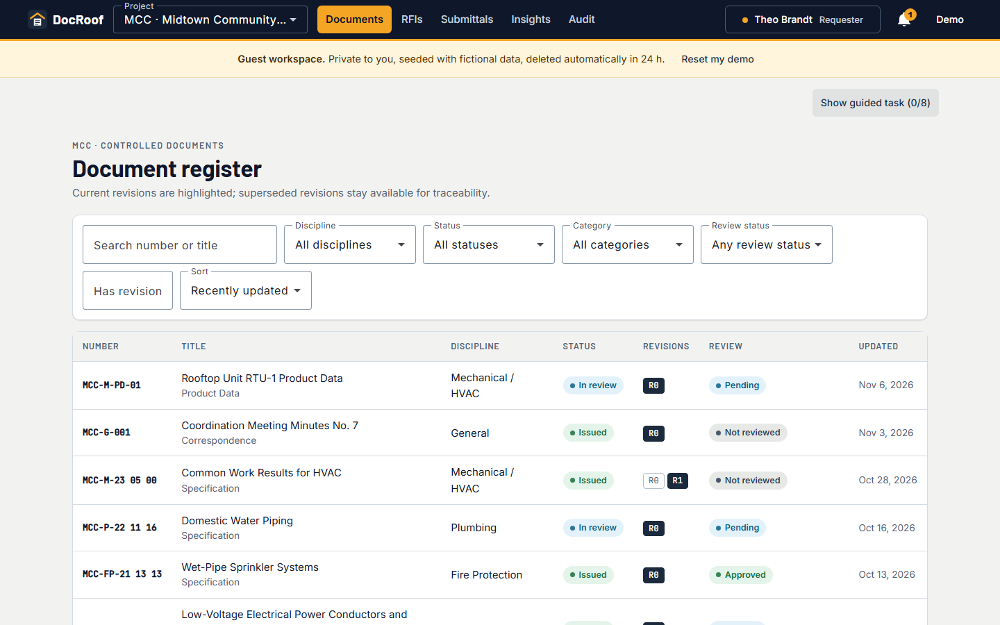

# DocRoof

**Every document, decision, and revision stays traceable.**

DocRoof is an enterprise-style construction **document control** system: versioned drawings and specifications,
RFIs, submittals, review assignments, approval histories and an append-only audit trail — built with Angular,
ASP.NET Core (.NET 10) and SQL Server 2022.

> Independent portfolio project. Not affiliated with, endorsed by, or a recreation of any company's systems.
> All people, projects and documents are fictitious.



## Status

Phases 1 and 2 of 3 are complete: documents and revisions, RFI and submittal workflows with approvals,
comments, audit trail, review queue, overdue reminders, notifications, live insights and the guided demo. Phase 3
(extraction, hardening, deployment readiness) is in progress. See [docs/STATUS.md](docs/STATUS.md) for exactly
what was run and the results.

## Quick start (Windows PowerShell)

Prerequisites: .NET SDK 10, Node.js 24 LTS, Docker Desktop.

```powershell
git clone <your fork URL> DocRoof; Set-Location DocRoof
./scripts/dev-up.ps1              # SQL Server 2022 on 127.0.0.1:14330, installs web dependencies
dotnet run --project api/src/DocRoof.Api --launch-profile http   # API on http://localhost:5180 (migrates + seeds)
# second terminal
Set-Location web; npm start       # app on http://localhost:4210
```

Open http://localhost:4210 and choose **Try the live demo**, or sign in at `/login` with a sample account such as
`controller.sample@docroof.test` / `DocRoofDemo2026` (intentionally public local-only password, see
[SECURITY.md](SECURITY.md)).

## Quick start (bash)

```bash
./scripts/dev-up.sh
dotnet run --project api/src/DocRoof.Api --launch-profile http &
cd web && npm start
```

## Tests

```powershell
dotnet test api/DocRoof.slnx                  # unit + integration (Testcontainers starts SQL Server; Docker required)
Set-Location web
npm run lint; npm run format:check
npm test -- --watch=false                     # Angular unit tests (Vitest)
npm run build
npx playwright test --project=chromium        # needs API (5180) and web (4210) running
```

## What is inside

| Area | Highlights |
| --- | --- |
| Document register | filters (discipline, status, category, review status, revision), server-side paging, revision chips |
| Revisions | immutable rows with SHA-256, supersession chain, metadata comparison, authorized streamed downloads |
| Files | magic-byte allow-list, size limit, generated storage keys, sanitized names, local-disk or SQL `varbinary` storage |
| RFIs | Draft → Submitted → Assigned → Answered → Closed (→ Reopened), PM approval before close, page-pinned citations |
| Submittals | one decision per cycle by the assigned reviewer, Revise & Resubmit with a newer revision, finalize |
| Oversight | review queue from a SQL view, idempotent overdue reminders, notification bell, live insights charts, filtered audit trail |
| Guest demo | isolated tenant per visitor cloned from the seed template, five personas, reset, 24 h cleanup |
| Security | Identity cookie + antiforgery, per-project role checks, 404 for cross-tenant access, rate limits, CSP |
| Database | FKs, unique and check constraints, rowversion, immutability and append-only triggers, documented review-queue view |

## Documentation

- [docs/PROJECT_SPEC.md](docs/PROJECT_SPEC.md) — full specification (all phases)
- [docs/ARCHITECTURE.md](docs/ARCHITECTURE.md) — components and request flow
- [docs/DATABASE.md](docs/DATABASE.md) — schema, constraints, indexes, the review-queue view
- [docs/API.md](docs/API.md) — REST endpoints and error model
- [docs/DECISIONS.md](docs/DECISIONS.md) — decision log
- [SECURITY.md](SECURITY.md) — controls, demo credentials, known gaps
- [docs/OWNER_TODO.md](docs/OWNER_TODO.md) — steps only the repository owner can do
- [AGENTS.md](AGENTS.md) — contributor guide and commands

## Licence

MIT — see [LICENSE](LICENSE). Synthetic sample PDFs are generated at runtime with PdfPig (Apache-2.0).
