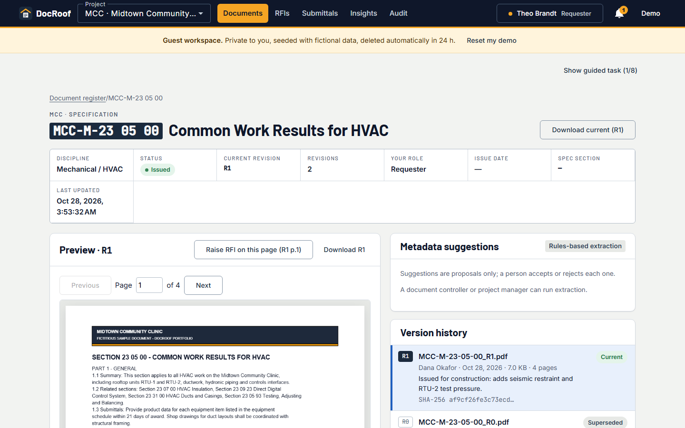
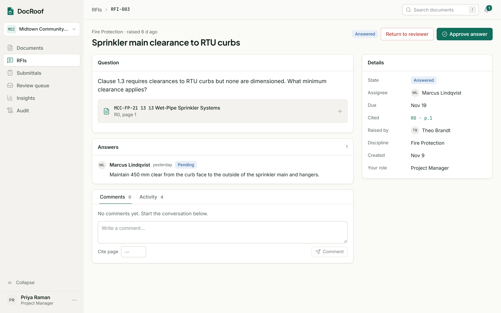
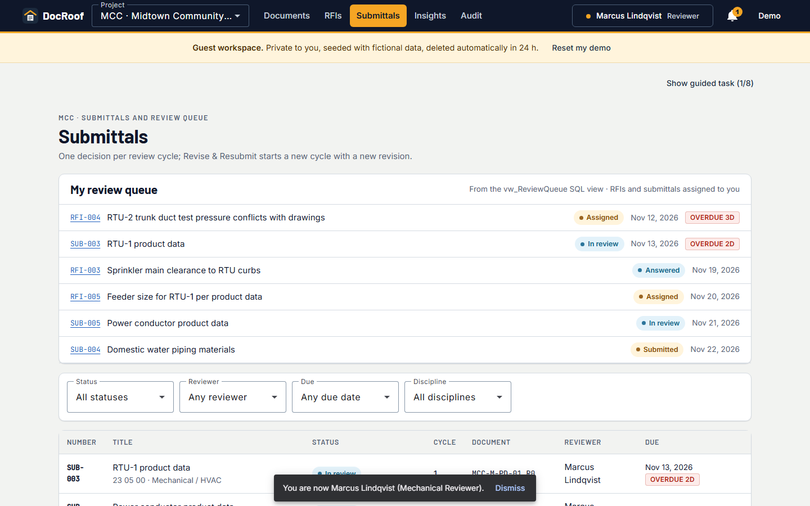
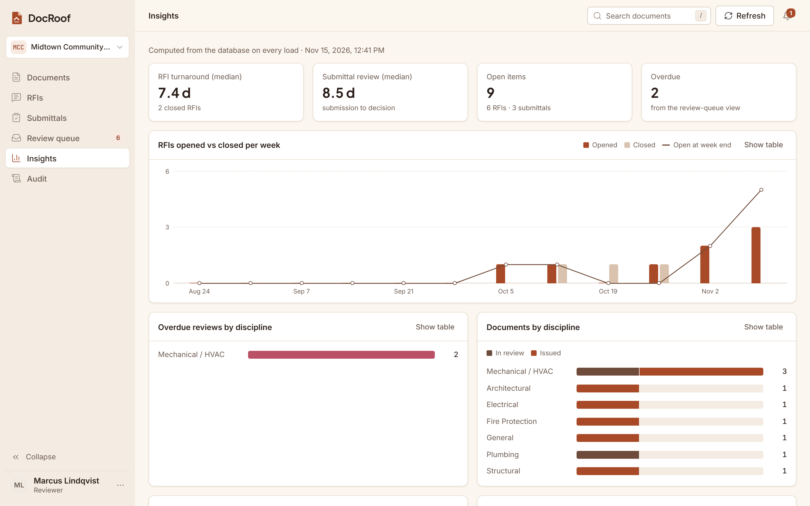

# DocRoof

**Every document, decision, and revision stays traceable.**

DocRoof is an enterprise-style construction **document control** system: versioned drawings and specifications,
RFIs that cite an exact revision and page, submittal reviews, approval histories, an append-only audit trail and
rules-based metadata extraction with page citations — built with Angular, ASP.NET Core (.NET 10) and SQL Server 2022.

> Independent portfolio project. Not affiliated with, endorsed by, or a recreation of any company's systems.
> All people, projects and documents are fictitious.


## Status

All three planned phases are built and tested locally (see [docs/STATUS.md](docs/STATUS.md) for every command and
its real result). **Hosted deployment is not complete** — it needs the owner's accounts; the image, infrastructure
templates and smoke scripts are ready ([docs/DEPLOYMENT.md](docs/DEPLOYMENT.md), [docs/OWNER_TODO.md](docs/OWNER_TODO.md)).

| Check (last local run, 2026-11-15) | Result |
| --- | --- |
| Backend unit tests (xUnit) | 121 passed |
| Backend integration tests (WebApplicationFactory + Testcontainers SQL Server 2022) | 57 passed |
| Angular unit tests (Vitest) | 23 passed |
| Playwright end-to-end (Chromium) | 9 passed |
| Lint / format (ESLint, Prettier, `dotnet format`) | clean |
| Dependency audits (`dotnet list package --vulnerable`, `npm audit --omit=dev`) | 0 known vulnerabilities |
| Production Docker image + `scripts/smoke.ps1` / `smoke.sh` | passed locally |
| Lighthouse, landing page, production image | mobile 72 / 100 / 100 / 100 · desktop 97 / 100 / 100 / 100 (perf / a11y / best practices / SEO) |

## Quick start (Windows PowerShell)

Prerequisites: .NET SDK 10, Node.js 24 LTS, Docker Desktop.

```powershell
git clone <repository URL> DocRoof; Set-Location DocRoof
./scripts/dev-up.ps1              # SQL Server 2022 on 127.0.0.1:14330, installs web dependencies
dotnet run --project api/src/DocRoof.Api --launch-profile http   # API on http://localhost:5180 (migrates + seeds)
# second terminal
Set-Location web; npm start       # app on http://localhost:4210
```

Open http://localhost:4210 and choose **Try the live demo**, or sign in at `/login` with a sample account such as
`controller.sample@docroof.test` / `DocRoofDemo2026` (intentionally public, local-only — see [SECURITY.md](SECURITY.md)).

`./scripts/dev-up.ps1 -StartApps` opens the API and web app in new windows. `./scripts/reset-local-db.ps1` drops the
local database and files.

## Quick start (bash)

```bash
./scripts/dev-up.sh
dotnet run --project api/src/DocRoof.Api --launch-profile http &
cd web && npm start
```

## Production image

```powershell
docker compose --profile app up -d --build        # SQL Server + production image on http://localhost:5180
./scripts/smoke.ps1 -BaseUrl http://localhost:5180
```

## Demo walkthrough

1. **Try the live demo** creates a private guest workspace (two fictional projects, 15 synthetic documents, 12 RFIs,
   8 submittals, 3 overdue items). It is deleted after 24 hours; **Reset my demo** rebuilds it.
2. Open `MCC-M-23 05 00` (Common Work Results for HVAC) and compare R0 with R1.
3. On R1 page 3 choose **Raise RFI on this page** and submit it.
4. Switch persona (top bar) to **Priya Raman, Project Manager** and assign **Marcus Lindqvist** with a due date.
5. Switch to Marcus and post an answer; switch back to Priya, approve it and close the RFI.
6. Open **Audit** to see every step with actor and timestamp. A banner tracks this guided task.
7. As **Dana Okafor (Document Controller)**, choose **Suggest metadata** on a specification: each suggestion cites its
   page; accept or reject it. The scanned drawing `MCC-A-101` shows the "no text layer" limitation.

| | |
| --- | --- |
|  |  |
|  |  |

## What is inside

| Area | Highlights |
| --- | --- |
| Document register | filters (discipline, status, category, review status, revision), server-side paging, revision chips |
| Revisions | immutable rows with SHA-256, supersession chain, metadata comparison, authorized streamed downloads, pdf.js preview |
| RFIs | Draft → Submitted → Assigned → Answered → Closed (→ Reopened), PM approval before close, page-pinned citations |
| Submittals | one decision per cycle by the assigned reviewer, Revise & Resubmit with a newer revision, finalize |
| Oversight | review queue from a documented SQL view, idempotent overdue reminders, notification bell, live insights, audit trail |
| Extraction | deterministic rules engine with page citations, confidence and rule; human accept/reject; optional language-model adapter (off) |
| Guest demo | isolated tenant per visitor from the seed template, five personas, guided task, reset, quotas, 24 h cleanup |
| Security | Identity cookies + antiforgery, per-project roles, 404 for cross-tenant IDs, magic-byte uploads, CSP/HSTS, rate limits, lockout |
| Database | FKs, unique and check constraints, rowversion, immutability and append-only triggers, `vw_ReviewQueue` |

## Architecture

Angular SPA → ASP.NET Core controllers → services (validation, authorization, transactions, audit) → EF Core → SQL
Server. In production one container serves both the API and the built Angular app (same origin, first-party cookies).
Diagrams and details: [docs/ARCHITECTURE.md](docs/ARCHITECTURE.md), [docs/DATABASE.md](docs/DATABASE.md).

## Tests

```powershell
dotnet test api/DocRoof.slnx                  # unit + integration (Testcontainers starts SQL Server; Docker required)
Set-Location web
npm run lint; npm run format:check
npm test -- --watch=false                     # Angular unit tests
npm run build
npx playwright test --project=chromium        # needs the API (5180) and web app (4210) running
npx playwright test --project=screenshots     # regenerates README/landing screenshots and the social image
```

The six must-pass domain tests are named `MustPass1_…` to `MustPass6_…` (trait `Category=MustPass`).

## Limitations

No malware scanning or OCR; rules-based extraction is tuned to title-block conventions; in-app notifications only;
PDF active-content detection is heuristic; mobile Lighthouse performance is limited by client-side rendering; hosted
deployment pending owner accounts. Full list: [SECURITY.md](SECURITY.md) and the case study page.

## Documentation

- [docs/PROJECT_SPEC.md](docs/PROJECT_SPEC.md) — full specification
- [docs/STATUS.md](docs/STATUS.md) — what works, commands run, real results
- [docs/ARCHITECTURE.md](docs/ARCHITECTURE.md) · [docs/DATABASE.md](docs/DATABASE.md) · [docs/API.md](docs/API.md)
- [docs/EXTRACTION.md](docs/EXTRACTION.md) · [docs/DEPLOYMENT.md](docs/DEPLOYMENT.md) · [docs/DECISIONS.md](docs/DECISIONS.md)
- [SECURITY.md](SECURITY.md) · [docs/OWNER_TODO.md](docs/OWNER_TODO.md) · [AGENTS.md](AGENTS.md)

## Licence

MIT — see [LICENSE](LICENSE). Synthetic sample PDFs are generated at runtime with PdfPig (Apache-2.0); in-app PDF
rendering uses pdf.js (Apache-2.0).
