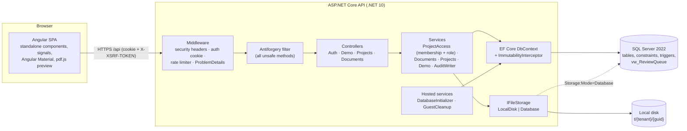

# Architecture

DocRoof is a modular monolith: one ASP.NET Core process, one SQL Server database, one Angular single-page app.

## Layers

| Project | Responsibility | Depends on |
| --- | --- | --- |
| `DocRoof.Domain` | Entities, enums, `RfiWorkflow`/`SubmittalWorkflow` state machines, `DueDates`, file rules (`FileSignatures`, `UploadRules`, `FileNameSanitizer`, `StorageKeys`, `Checksums`) | nothing |
| `DocRoof.Infrastructure` | `DocRoofDbContext`, migrations and hand-written SQL objects, storage implementations, PDF inspection/generation, seeding, application services, background services | Domain, EF Core, Identity, PdfPig |
| `DocRoof.Api` | Controllers, cookie auth, antiforgery filter, rate limiting, security headers, ProblemDetails mapping, health checks, static SPA hosting | Infrastructure |

## Request lifecycle (example: upload a new revision)

1. Angular posts `multipart/form-data` to `POST /api/documents/{id}/revisions` with the auth cookie and
   `X-XSRF-TOKEN` header.
2. The rate limiter (`upload` policy, per user) and the antiforgery filter run before the controller.
3. `DocumentService.AddRevisionAsync` asks `ProjectAccessService` for the document's project membership inside the
   caller's tenant (404 if none, 403 unless Document Controller or Project Manager).
4. `UploadRules` sniffs magic bytes, checks extension and size; PdfPig reads page count, text layer and active
   content markers.
5. Inside one transaction: bytes are written under a generated key, a new `DocumentRevision` row is inserted,
   the document's `CurrentRevisionId` moves forward (rowversion-checked) and an `AuditEvent` is added.
6. Failures roll back the transaction and remove any local-disk bytes; exceptions become ProblemDetails.

## Tenancy and the guest demo

- Every `Project` and Identity user belongs to one `Tenant`. Every other row hangs off a project.
- `POST /api/demo/start` creates a guest tenant (24 h TTL) from the seed template and signs the visitor in as the
  requester persona. Persona switching signs in another user of the **same** guest tenant only.
- `GuestCleanupService` deletes expired guest tenants (rows in dependency order, then files).
- Per-IP quotas use a salted hash of the client address stored on the tenant row; a global cap limits active
  workspaces.

## Frontend

- Routes: `/` landing, `/case-study`, `/login`, `/demo`, `/app/documents`, `/app/documents/:id`, 403/404 pages.
- `SessionService` holds the signed-in identity (signals) and refreshes the antiforgery token whenever the identity
  changes; `authGuard` protects `/app`.
- `errorInterceptor` turns ProblemDetails into toasts unless a call opts out with the `SILENT_ERRORS` context token.
- Previews: PDFs are rendered to a canvas with pdf.js (no document scripts run), TXT is shown as escaped text,
  images via blob URLs.

Workflow (RFI/submittal) state diagrams are added in Phase 2.
