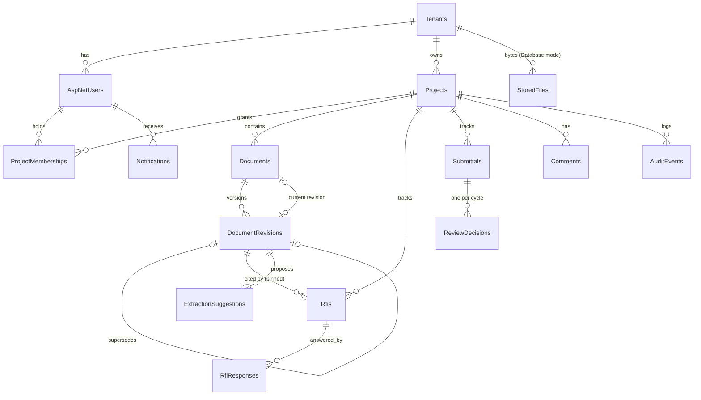

# Database

SQL Server 2022, schema managed by EF Core migrations in
`api/src/DocRoof.Infrastructure/Data/Migrations`. Hand-written T-SQL objects live in
`Data/DatabaseObjects.cs` and are created by the initial migration.

## Entity overview



## Integrity rules

| Rule | Mechanism |
| --- | --- |
| Project code unique per tenant | unique index `(TenantId, Code)` |
| One membership per user per project | unique index `(ProjectId, UserId)` |
| Document number unique per project | unique index `(ProjectId, DocumentNumber)` |
| Revision label unique per document | unique index `(DocumentId, VersionLabel)` |
| RFI reference unique per project | unique index `(ProjectId, ReferenceNumber)` |
| Submittal number unique per project | unique index `(ProjectId, Number)` |
| One review decision per submittal cycle | unique index `(SubmittalId, Cycle)` |
| Reminder idempotency | filtered unique index on `Notifications.DedupeKey` |
| Valid state values | check constraints on every enum column (`CK_Rfis_State`, `CK_Submittals_Status`, …) |
| Positive pages / sizes | `CK_Rfis_SourcePage`, `CK_DocumentRevisions_PageCount`, `CK_DocumentRevisions_ByteSize` |
| Revision content immutable | `trg_DocumentRevisions_Immutable` (AFTER UPDATE, `THROW 51001`) + EF interceptor + service layer |
| Audit trail append-only | `trg_AuditEvents_AppendOnly` (AFTER UPDATE, `THROW 51002`) + EF interceptor |
| Optimistic concurrency | `rowversion` on `Documents`, `DocumentRevisions`, `Rfis`, `Submittals`, `ExtractionSuggestions` |
| Referential integrity | foreign keys everywhere, `ON DELETE NO ACTION` (tenant purge deletes in dependency order) |

Enums are stored as `varchar(40)` strings so the database stays readable and the check constraints are explicit.
All timestamps are UTC `datetime2(3)`.

## Indexes for list and filter queries

| Index | Serves |
| --- | --- |
| `Documents (ProjectId, Discipline, Status)` | register filters |
| `Documents (ProjectId, UpdatedAt)` | default "recently updated" sort |
| `Rfis (ProjectId, State, DueAt) INCLUDE (AssigneeId)` | RFI lists and the review queue view |
| `Rfis (AssigneeId, State)` | "assigned to me" |
| `Submittals (ProjectId, Status, DueAt) INCLUDE (AssignedReviewerId)` | submittal queue and the review queue view |
| `AuditEvents (ProjectId, Timestamp)`, `(Resource, ResourceId, Timestamp)` | audit feed and per-resource timelines |
| `Notifications (RecipientId, ViewedAt, CreatedAt)` | unread count and bell |

## The review-queue view (`dbo.vw_ReviewQueue`)

```sql
SELECT 'Rfi' AS ItemType, r.Id AS ItemId, r.ProjectId, p.TenantId, r.ReferenceNumber AS Reference,
       r.Subject AS Title, r.State, r.AssigneeId, r.DueAt, d.Discipline,
       CAST(CASE WHEN r.DueAt < SYSUTCDATETIME() THEN 1 ELSE 0 END AS bit) AS IsOverdue,
       CASE WHEN r.DueAt < SYSUTCDATETIME() THEN DATEDIFF(day, r.DueAt, SYSUTCDATETIME()) END AS DaysOverdue
FROM dbo.Rfis r
JOIN dbo.Projects p ON p.Id = r.ProjectId
JOIN dbo.DocumentRevisions rev ON rev.Id = r.SourceRevisionId
JOIN dbo.Documents d ON d.Id = rev.DocumentId
WHERE r.State IN ('Submitted', 'Assigned', 'Answered', 'Reopened')
UNION ALL
SELECT 'Submittal', s.Id, s.ProjectId, p.TenantId, s.Number, s.Title, s.Status, s.AssignedReviewerId, s.DueAt,
       d.Discipline, ... -- same overdue expressions
FROM dbo.Submittals s
JOIN dbo.Projects p ON p.Id = s.ProjectId
JOIN dbo.Documents d ON d.Id = s.DocumentId
WHERE s.Status IN ('Submitted', 'InReview');
```

**Why a view:** RFIs and submittals are different aggregates, but reviewers and managers need one queue. The view
gives a single, consistent definition of "open", "assigned" and "overdue" that the API, the reminder job and ad-hoc
reporting all share, instead of duplicating the logic in LINQ.

**Why it is cheap:** both branches filter on the leading columns of `(ProjectId, State|Status, DueAt)` indexes that
`INCLUDE` the assignee, so a query such as
`SELECT … FROM vw_ReviewQueue WHERE ProjectId = @p ORDER BY DueAt` becomes two index seeks plus small key lookups for
the joined discipline, then a merge. `UNION ALL` (not `UNION`) avoids a sort/distinct because the branches can never
overlap. `IsOverdue` is computed against `SYSUTCDATETIME()` at query time, so no scheduled job is needed to keep a
flag column in sync. The view is non-schemabound and not indexed, because its overdue flag is time-dependent.

EF Core maps the view as a keyless entity (`ReviewQueueItem`, `ToView("vw_ReviewQueue")`). It is read by
`GET /api/projects/{id}/review-queue`, by the insights endpoint (overdue by discipline) and by
`OverdueReminderService` (which inserts one reminder per item, assignee and day).

## Transactions

Every service mutation runs inside an explicit transaction together with its `AuditEvent` rows. Uploads write the
file first (Database storage mode joins the same transaction; local-disk bytes are deleted on rollback).

## Local operations

- Create/upgrade: the API applies migrations at startup when `Database:MigrateOnStartup=true` (on in Development).
- Reset: `./scripts/reset-local-db.ps1` drops the local database and `data/files`.
- New migration: see AGENTS.md.
